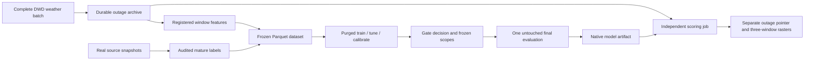

# Operating the downstream CPU model job

The raster pipeline is unchanged. Model jobs consume a complete, verified
`raster-batch/v1`; model failure cannot mutate or fail that weather publication.
Run archive preservation immediately after weather publication. Run scoring
only with an already fitted, checksum-validated model. Never train in the
hourly scoring process. Forecast software availability is not training readiness.



## Environment and commands

Use Python 3.12 and `requirements-model.lock` in a separate model environment
when deploying. The implementation was checked in the existing compatible
Python 3.12 environment without upgrading raster dependencies; additional model
packages use about 0.2 GB. No CDO, ecCodes decoding, GPU, model server, database,
or Python pickle is required by the downstream container. The model-only image
is defined in `Dockerfile.model`; the existing raster image remains separate.

Run from `power_outage_model/`. Every command prints JSON; failures return exit
code 2. Save the exact JSON reference object printed by a command to the file
named by the subsequent `--*-ref` argument. For commands with a result wrapper,
extract its `model_ref` or `splits` field. All object references contain key and
SHA256; local ref files are small handles, not a second artifact copy.

```sh
python -m outage_model.cli --store output readiness
python -m outage_model.cli --store output collect
python -m outage_model.cli --store gs://YOUR_BUCKET archive-weather \
  --manifest-key raster/v1/runs/REAL_BATCH_ID/manifest.json \
  --raw-root /data/cache --normalization-assets /data/normalization-assets.json
python -m outage_model.cli --store gs://YOUR_BUCKET build-dataset \
  --spec /data/dataset-spec.json --freeze-time 2027-12-01T00:00:00Z
python -m outage_model.cli --store gs://YOUR_BUCKET split \
  --dataset-ref /data/dataset-ref.json --policy /data/split-policy.json
python -m outage_model.cli --store gs://YOUR_BUCKET train \
  --dataset-ref /data/dataset-ref.json --splits /data/splits.json
python -m outage_model.cli --store gs://YOUR_BUCKET audit-development \
  --model-ref /data/model-ref.json --dataset-ref /data/dataset-ref.json \
  --splits /data/splits.json --kind state
python -m outage_model.cli --store gs://YOUR_BUCKET evaluate \
  --model-ref /data/model-ref.json --dataset-ref /data/dataset-ref.json \
  --splits /data/splits.json --evaluation-spec /data/evaluation-spec.json --role gate
python -m outage_model.cli --store gs://YOUR_BUCKET evaluate \
  --model-ref /data/model-ref.json --dataset-ref /data/dataset-ref.json \
  --splits /data/splits.json --evaluation-spec /data/final-spec.json --role test
python -m outage_model.cli --store gs://YOUR_BUCKET score \
  --archive-ref /data/archive-ref.json --model-ref /data/promoted-model-ref.json --publish
python -m outage_model.cli --store gs://YOUR_BUCKET validate-batch --batch-key outage/v1/runs/ID/manifest.json
python -m outage_model.cli --store gs://YOUR_BUCKET explain --batch-key outage/v1/runs/ID/manifest.json --row-id ROW_SHA256
```

Examples specify real external files and a user-owned bucket. They do not ship
fabricated historical inputs, stand up a toy endpoint, create a bucket, configure
credentials or deploy resources. Configure normal workload identity/IAM for the
job's existing bucket. The workload must be allowed immutable object creation,
read and generation-conditional pointer replacement in its own namespace.

The archive must be in the same object store as the weather batch for this v1
adapter. Use a durable remote store for retained real forecast history. Local
raw caches are read only when explicitly under `--raw-root`. Optional
normalization assets are a JSON list of `{role,path,sha256}` or
`{role,key,sha256}` entries covering native geometry and recorded remap weights.
References in the remapping manifest preserve original keys and hashes.

## Required input files

- `dataset-spec.json`: `archives` (ArchiveRef list), `event_snapshot_refs`
  (checksum references printed by collection), `coverage_ref` (checksum JSON
  list of reviewed CoverageInterval records), `label_policy` (version,
  reporting_lag_hours, accepted_geometry_meanings, source_priority and reviewed
  duplicate_aliases), `row_metadata_ref` (checksum JSON object keyed by RowKey
  SHA256 with state, region, block_id and season). Metadata may omit unsupported
  cells. No matching complete coverage means no binary training row.
- `split-policy.json`: version, `boundaries` mapping train/tune/calibrate/gate/test
  to exact `[UTC_start,UTC_end]` pairs, embargo_hours >=72, held_out_states,
  held_out_domains and the reviewed event-block artifact hash. Approximate
  50/15/15/10/10 proportions do not override temporal/event independence.
- `evaluation-spec.json`: predeclared `scopes`, each with scope_id, grid_id,
  horizon_id, season, domain_id, region, exact `[row,col]` cells and coverage
  evidence. Also checksum `audit_refs`: lineage_audit, explanation_audit,
  geographic_holdouts, storm_holdouts, grouped_importance. Final spec adds
  `gate_evidence_ref`. Scope geometry is represented by the union of the exact
  grid cells; never grant a whole state based on partial utility coverage.
- Production model decisions use pinned train/release policies. A policy revision
  must get a new version and future untouched test period. The final-test claim
  is immutable and consumed before scoring; a crash requires explicit operator
  investigation rather than quietly rerunning selection against the same test.

`audit-development` supports state, domain_id and block_id. It refits selection,
scaling, calibration and support without the held-out group. Storm experiments
also purge later fitting rows and apply a 72-hour temporal gap. Folds with
insufficient history remain ineligible. These jobs can be expensive; no test
subset is silently substituted for the real experiment.

`route_regions` accepts a checksummed authoritative state GeoJSON with STUSPS,
routes by cell center and records boundary flags using the pinned NOAA-style
membership table. Geometry is not bundled or guessed. Exact ambiguous boundary
centers route to unknown with no automatic validation.

## Storage and resource ownership

The default local budget is **5,000,000,000 bytes**; `--budget-gb` can raise it to
at most **10,000,000,000**. The budget root must include the output directory,
environments and all related local caches. Writes reserve an atomic staging
copy. Temporary COG staging stays inside that root and is removed on completion.
There is no automatic data deletion. Archive/model/data objects are immutable
and content-addressed, so duplicate bytes are reused. Only selected native
models/tree dumps and trial metadata are persisted; discarded candidates do not
create hundreds of model files. Features use Zstandard Parquet. Contributions
are produced on demand instead of a large feature-raster stack.

A local budget is not permission to discard history needed for validation.
If it would be exceeded, the job fails before that write. Use a remote durable
archive and reviewed cache cleanup. Native geometry/remap assets can be large;
copy them once remotely by content hash. Missing raw inputs or remap assets keep
`normalization_reproducible=false`, and live training rejects those archives even
though normalized feature replay can remain available.

Current bounded in-memory training accepts up to one million reviewed rows per
CPU job. Dataset assembly drops unreviewed CONUS cells before retaining multiple
archive matrices. Larger datasets require reviewed time/domain partitions and
resource planning; do not downsample positives or replace unavailable geography.
The CPU configuration uses four threads, shallow trees, early stopping and a
bounded search. Check actual job memory/runtime with real data before scheduling.

The local report measures the directory tree. Pre-existing Docker images,
shared build caches and remote storage are separate allocations and must be
included in an operator's total footprint. This change does not delete unrelated
images/caches or build an additional image in the user's local Docker store.
Model Dockerfile excludes training data, raw caches, .venvs, tests and fixtures
from copied runtime layers. Build in CI or the deployment builder:

```sh
docker build -f Dockerfile.model -t outage-model:VERSION .
docker run --rm -v /PATH/TO/DATA:/data outage-model:VERSION \
  --budget-root /data --store gs://YOUR_BUCKET readiness
```

## Publication and recovery

`outage/v1/latest.json` is independent of `raster/v1/latest.json`. Explicit
`--test-mode` output uses `outage/v1/testing/latest.json`; fixtures cannot be
loaded by live commands. A complete prediction has three Float32 probability
COGs, three UInt8 status COGs and three separate Float32 fallback-score COGs,
plus exact scored features, full representative explanations and model/archive
references. Overviews use nearest sampling and retain original-cell meaning.

Status: 0 outside analysis land; 1 validated local probability; 2 insufficient
validation; 3 outside feature support; 4 invalid input; 5 stale forecast.
Probability is NoData=-9999 outside status 1. Status NoData is 255. The fallback
is the maximum of exactly 24 valid hourly environmental scores, not calibrated
probability. Never combine score and probability values in a palette/field.

Consumers must recompute age using the original weather cutoff. Reusing a batch
never resets it; after two hours, show stale/unavailable rather than a fresh
fallback. Source-run, cutoff and publication ages are separately exposed.
County/household aggregation of these probabilities is not defined in v1.

Immutable writes precede compare-and-swap pointer publication. A bad/partial
batch cannot displace the current pointer. A previous complete pointer is saved.
`rollback --expected-generation TOKEN` validates that batch and conditionally
restores it. Rollback does not refresh weather timestamps. No upstream retention
logic is changed; remote lifecycle rules must preserve outage archives, training
snapshots, promoted models and both current/recovery output dependencies.

## Health and review

Operate alerts for missed/failed/stale collection, changed schema/ID churn,
missing raw/normalized archives, expired weather, unexpected null-label or
coverage rates, local quota exhaustion and CAS races. Reconcile delayed labels
with a new immutable freeze. Measure calibration and feature/hazard/domain drift
on mature real labels; an unobserved region stays unsupported even when its
features look plausible. Review model age and static vintage alongside fresh
weather. Quarterly review is a proposed manual cadence, not an automation.

## Producing the required audit records

Run `audit-development` for each of `state`, `domain_id` and `block_id`, save
the three printed checksum refs as a JSON list, then run:

```sh
python -m outage_model.cli --store gs://YOUR_BUCKET make-audits \
  --model-ref /data/model-ref.json --dataset-ref /data/dataset-ref.json \
  --splits /data/splits.json --development-refs /data/development-refs.json
```

The returned mapping is the evaluation spec's `audit_refs`. This creates
candidate/dataset/split-bound `outage-audit/v1` records for lineage, explanation
reconstruction, geographic/storm experiments, grouped permutation importance,
contribution distributions and numerical response curves with feature-support
marks. All use development rows only. Refits with too little independent history
remain explicitly ineligible. Audit completion records describe the measured
outcome, including negative skill; they do not grant transfer approval.

Evaluation requires successful typed audit records, two or more eligible
holdout folds and exact trained dataset/split identities. A reference to arbitrary
JSON cannot satisfy an audit. The scope fails if a required geography or hazard
slice has insufficient evidence; it does not acquire coverage merely because a
pooled metric passes. Wind/rain 90th/99th-percentile, temperature 10th/90th and
canopy one-third/two-third severity boundaries are derived from the training-only
support reference. `spatial_boundary` must come from reviewed geographic metadata.
These conservative rules can require substantial multiyear history.
